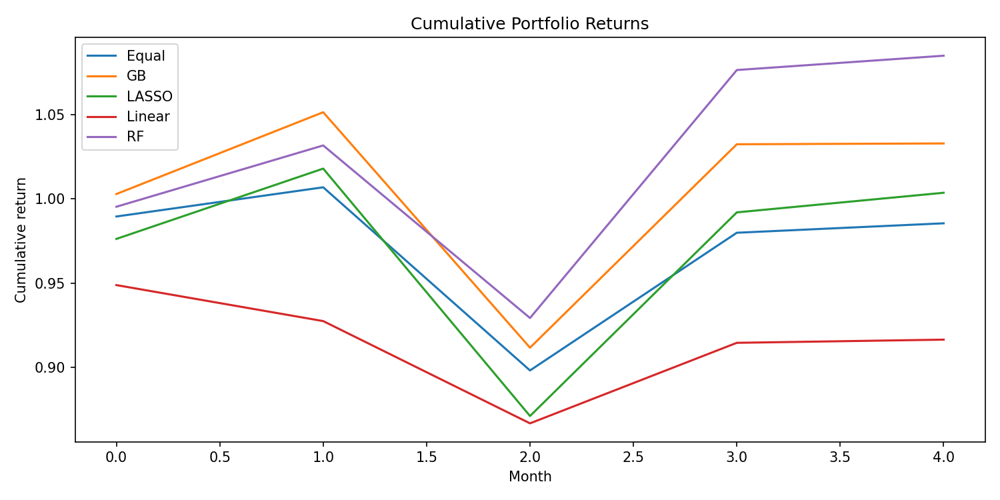
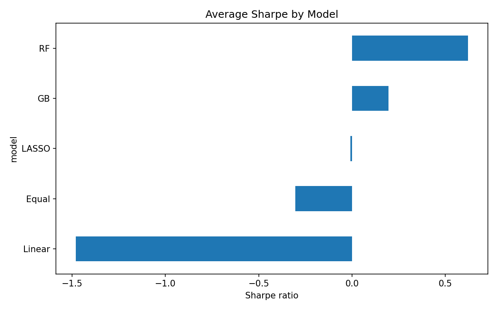
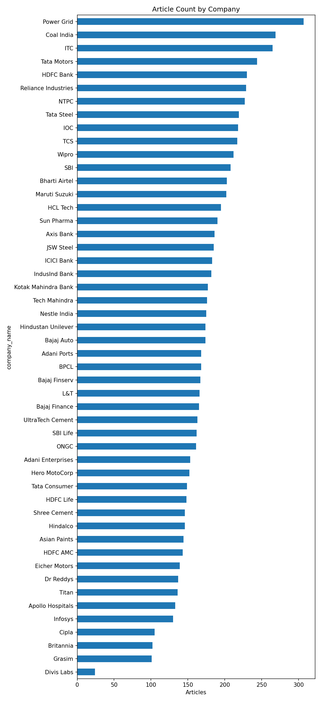

# ESG News Sentiment Portfolio Construction (NIFTY 50)

A pipeline that turns news headlines about companies into ESG and SDG sentiment signals, combines them with price features, and backtests stock-selection portfolios on the NIFTY 50 using machine learning.

Inspired by Feng et al., *Sustainable Portfolio Construction via Machine Learning: ESG, SDG and Sentiment*, European Financial Management (2025). DOI: [10.1111/eufm.12531](https://doi.org/10.1111/eufm.12531). The paper studies the S&P 500. This project applies a simplified version of its approach to Indian large caps.



## Pipeline

```
News collection ─► NLP scoring ─► Daily company scores ─┐
 (GDELT / Google    (VADER + ESG/SDG/                     ├─► Model dataset ─► ML models ─► Monthly backtest ─► Sharpe / charts
  News RSS)          controversy lexicons)                │
                              Stock prices (yfinance) ────┘
```

| Stage | What happens |
|---|---|
| 1. Universe | The 50 NIFTY 50 constituents, each with an NSE symbol, a yfinance ticker and name aliases for news matching |
| 2. News | ESG-focused headlines per company from GDELT, with a Google News RSS fallback. The saved run collected **8,755 headlines** |
| 3. Scoring | VADER sentiment scaled to −100…+100, plus keyword counts for Environmental, Social, Governance, SDG and controversy terms (compiled regex, vectorized) |
| 4. Daily scores | Aggregated per company per day into overall, ESG-weighted and SDG-weighted sentiment and a controversy ratio |
| 5. Market data | Daily adjusted returns for all tickers and the `^NSEI` benchmark: lagged returns, 20-day rolling volatility, excess return |
| 6. Models | Linear Regression, LASSO, Random Forest and Gradient Boosting predict **next-day return** from 19 sentiment and price features, trained on a chronological 70/30 split |
| 7. Backtest | Each test month, hold the top 10 stocks by predicted return with equal weights. Benchmark: all stocks, equal weight |

## Results

Period: 7 May 2025 to 7 May 2026. Test window: the last ~30% of trading days (5 monthly rebalances). Risk-free rate: 6.5%.

| Portfolio | Ann. return | Ann. volatility | Sharpe |
|---|---:|---:|---:|
| Random Forest, top 10 | **26.5%** | 32.1% | **0.62** |
| Gradient Boosting, top 10 | 13.0% | 33.3% | 0.20 |
| LASSO, top 10 | 6.2% | 35.7% | −0.01 |
| Equal-weight benchmark (49 stocks) | −1.0% | 24.7% | −0.30 |
| Linear Regression, top 10 | −18.0% | 16.5% | −1.48 |

At the prediction level, all four models have an out-of-sample R² close to zero (between −0.02 and −0.001). This matches the well-known result that daily stock returns are close to unpredictable. The portfolio differences come from how the models rank stocks, not from accurate return forecasts.

<p>
  
  
</p>

## Limitations

- **Short test window.** Five monthly observations are too few for the Sharpe differences to be statistically significant.
- **Look-ahead in stock selection.** Each month's stocks are ranked by the average of that month's daily predictions, so the ranking uses information from inside the holding period. Ranking only on predictions available on the rebalance date would fix this.
- **Sparse news coverage.** Only about 20% of stock-days (2,427 of 12,103) have at least one headline.
- **Headline-only, lexicon-based ESG scoring.** Keyword counts are a rough proxy for ESG content. A finance-tuned model such as FinBERT or ESG-BERT would be more precise.
- **No transaction costs** are applied in the backtest.

## Future work

- Rebalance without look-ahead, using a rolling or expanding training window
- Mean-variance and mean-semivariance weighting, as in the paper
- Transformer-based ESG classification and sentiment
- A longer history with a proper walk-forward evaluation

## Repository structure

```
├── esg_sentiment_portfolio.ipynb   # full pipeline, runs top to bottom
├── data/
│   ├── raw/
│   │   ├── nifty50_companies.csv   # universe and news-matching aliases
│   │   └── raw_news.csv            # snapshot of collected headlines (title, link, date)
│   └── processed/                  # generated when you run the notebook (git-ignored)
├── outputs/
│   ├── figures/                    # charts
│   ├── tables/                     # portfolio returns and performance
│   └── models/                     # model error metrics
└── requirements.txt
```

## How to run

```bash
git clone https://github.com/<your-username>/esg-sentiment-portfolio-nifty50.git
cd esg-sentiment-portfolio-nifty50
python -m venv .venv
.venv\Scripts\activate          # Windows  (macOS/Linux: source .venv/bin/activate)
pip install -r requirements-notebook.txt
jupyter notebook esg_sentiment_portfolio.ipynb
```

The notebook reuses the saved news snapshot in `data/raw/raw_news.csv`, so the results can be reproduced. Delete that file to collect fresh headlines. Stock prices are downloaded from yfinance for the fixed date range set in the configuration cell.

## Tech stack

Python · pandas · NumPy · scikit-learn · vaderSentiment · yfinance · matplotlib · Jupyter

## Disclaimer

This is a research and educational project, not investment advice.


## Interactive Vercel dashboard

This original repository includes **Verdant**, a redesigned ESG/ML research interface with a dark charcoal and emerald visual system. It reads the committed monthly return outputs, recalculates portfolio statistics for selected dates and assumptions, explores the scored original news snapshot, and scores new headlines using the original VADER and keyword logic. It does not retrain models on page load or implement reinforcement learning.

Import this repository on Vercel with Framework **FastAPI**, root directory `./`, no environment variables, and default build/install/output settings. See [VERCEL_DEPLOYMENT.md](VERCEL_DEPLOYMENT.md) for PowerShell deployment steps, features and limits.

For the web app: `pip install -r requirements.txt` and `uvicorn index:app --reload`.

For the unchanged notebook pipeline: `pip install -r requirements-notebook.txt` and open `esg_sentiment_portfolio.ipynb`.

The dashboard preserves and prominently labels the original backtest's look-ahead bias, short sample, partial final month and missing transaction costs.
